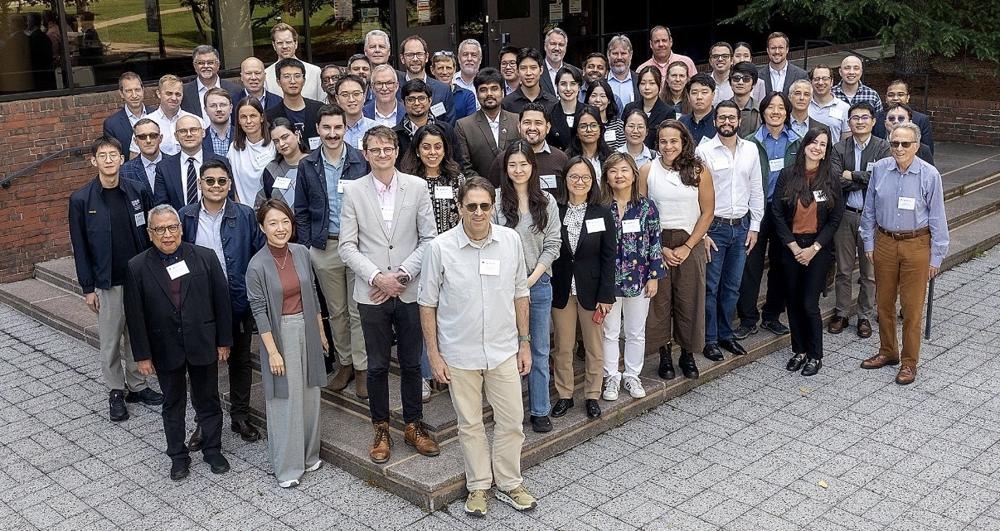
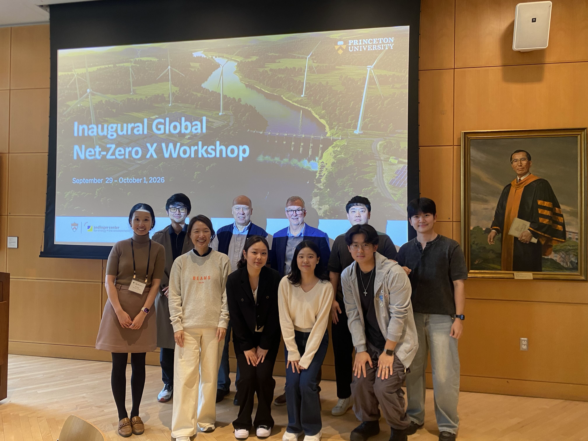
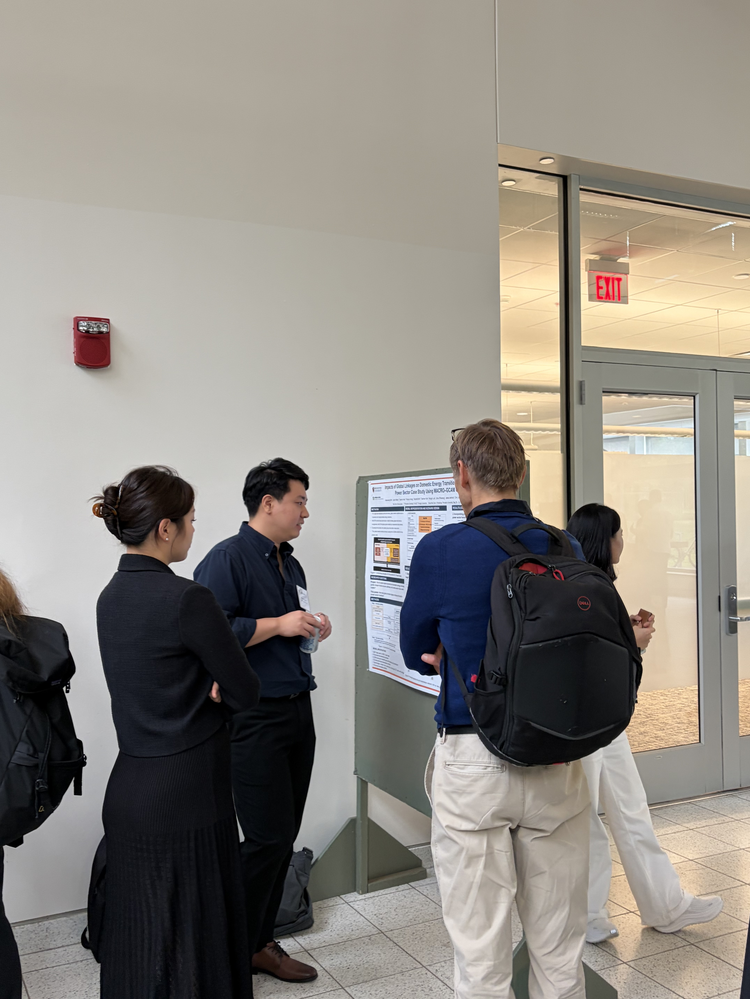

*Sungeun Kim represented the KAIST IAM Group at the inaugural Global Net-Zero X Workshop at Princeton University, joining researchers from around the world for four days of exchange on pathways to global net-zero emissions.*

{fig-align="center" width="650"}

[Sungeun Kim](https://www.linkedin.com/in/sungeun-kim-26ab5211b/), a PhD student in our KAIST IAM Group at the [KAIST Graduate School of Green Growth & Sustainability (GGGS)](https://gggs.kaist.ac.kr/), participated in the inaugural Global Net-Zero X (NZX) Workshop, hosted by [Princeton University](https://www.princeton.edu/)'s [Andlinger Center for Energy and the Environment](https://acee.princeton.edu/).

Over four days, the workshop brought together researchers and experts from around the world to exchange insights, explore diverse perspectives, and discuss pathways toward achieving global net-zero emissions.

{fig-align="center" width="650"}

Reflecting on the experience, Sungeun shared:

> "It was a fruitful and insightful workshop, offering valuable opportunities to learn from research around the world and exchange ideas on net-zero transitions. I'm excited to continue contributing to the Net-Zero Korea (NZK) team, advancing our research on coupling GCAM and MACRO, and preparing to share our work at the upcoming IAMC conference!"

{fig-align="center" width="650"}

We look forward to continued collaboration through the Global Net-Zero X initiative!