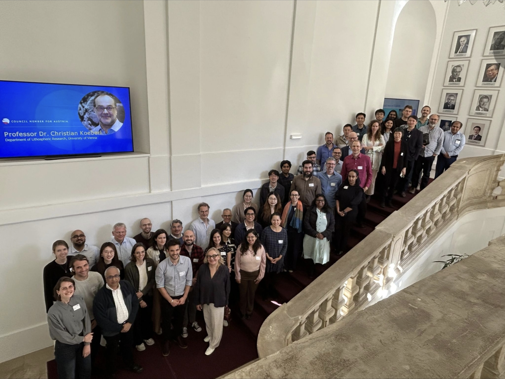
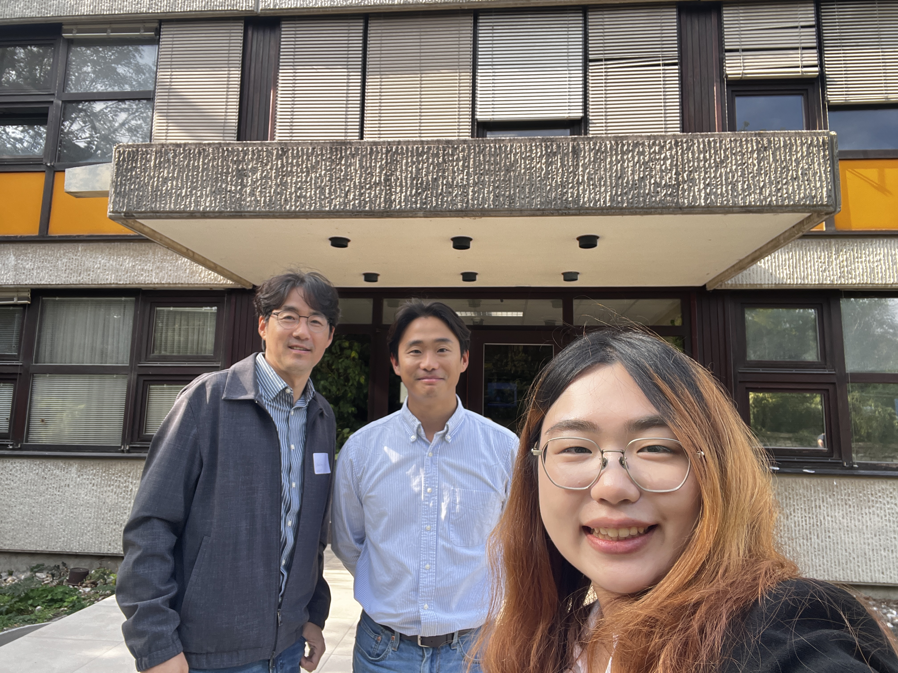

*Prof. Cheolhung Cho of the KAIST Center for Sustainable Development and PhD candidate Jiwon Kwun of the KAIST IAM Group participated in the third NEWPATHWAYS Project Meeting, held from 5 to 7 October 2026 in Laxenburg, Austria.*

{fig-align="center" width="1500"}

Hosted by the International Institute for Applied Systems Analysis (IIASA), the meeting brought together researchers, modelers and policy experts from around the world to advance collaboration on the next generation of climate scenarios.Within the project, WP5 (Development of National and EU pathways) develops Paris-aligned national and EU decarbonization pathways through integrated modeling, sectoral deep dives, feasibility assessments, and just transition analyses, ensuring that climate mitigation strategies are not only ambitious but also realistic and implementable.

The KAIST team presented ongoing progress in developing Korea’s net-zero pathways and contributed Korea’s national modeling perspective to discussions on common scenario assumptions. The team also participated in WP5 sessions shaping future research agendas on fossil fuel phaseout and financing for low-carbon transitions. Discussions with international research teams strengthened exchanges between national and global scenario development and opened opportunities for future model comparisons. The meeting also provided opportunities to build research connections and exchange ideas on advancing power sector modeling for long-term energy transition analysis.

Funded by the EU Horizon, NEWPATHWAYS explores where the world is heading without additional climate action and what pathways aligned with the Paris Agreement’s 1.5°C goal could look like. The project seeks to strengthen fairness and regional representation by integrating insights from national modeling teams and highlighting development needs.

{fig-align="center" width="1500"}

We look forward to continued collaboration through NEWPATHWAYS to connect national perspectives with global climate goals.
