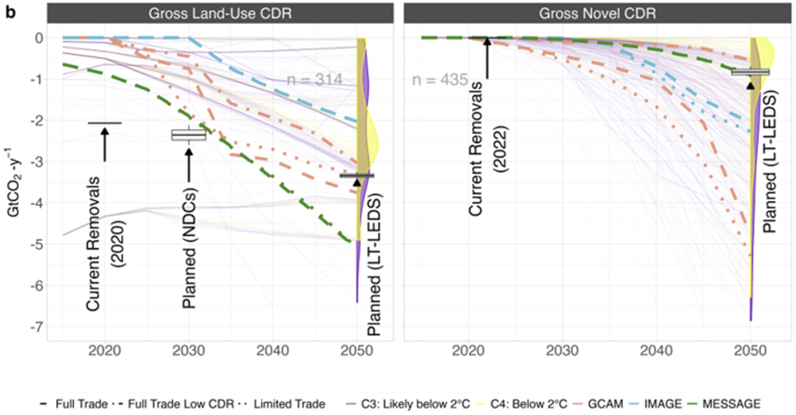

*A multi-model assessment using GCAM, IMAGE, and MESSAGE analyzes conventional land-use and novel CDR (carbon dioxide removal) pathways, and their role in achieving stated global climate commitments.*

The research compares how CDR portfolios affect GHG emissions and CO2 removals across models, scenarios, and regions, and examines the resulting temperature projections. The study also highlights the need for models to better represent a broader portfolio of CDR options, as they play a crucial role in achieving countries’ climate pledges. Additionally, international emissions trading mechanisms may also help reduce carbon costs, but clear rules on crediting, accounting, and monitoring must be established first.

{fig-align="center"}

Carbon Dioxide Removal is often discussed about as if it’s a given, but the actual deployment details remain a big question mark. This new model intercomparison study examines the role of CDR pathways in achieving global climate commitments under near-term deployment constraints.

Using integrated assessment models GCAM, IMAGE, and MESSAGE, this study examines projected portfolios of CDR technologies under realistic near-term constraints, and their role in achieving NDCs and LT-LEDS. Key findings show that all models project GtCO2/yr-scale conventional CDR from land-use change, projecting that the land sector transitions from an emissions source to a sink by mid-century. For novel CDR such as BECCS, ERW, and DACCS, MESSAGE projects about 1 GtCO2/yr, while GCAM and IMAGE both project multiple GtCO2/yr of BECCS and ERW by mid-century, as well as 0.4 GtCO2/yr of DACCS in GCAM.

The analysis also emphasizes that CDR portfolios should be better represented in modeling scenarios, as they can reveal more realistic, lower-cost opportunities for near-term mitigation, rather than assuming an unrealistic scale-up. Additionally, full or limited emissions trading mechanisms under Article 6 can play a role, provided that rules resolving double-counting and reversal risks are established first.

“Carbon dioxide removal methods are critical to achieving countries’ climate commitments, but they cannot simply be conjured out of thin air,” said Prof. Haewon McJeon of the KAIST Graduate School of Green Growth and Sustainability. “Realistic technology portfolios and deployment timelines must be taken into account, and be backed by targeted policies and incentives.”

The results of this study provide critical insights that can be used to support the development of more precise, pathway-specific CDR targets by nations, strengthening the clarity and ambition of upcoming NDC updates.

한국어 요약

국제 기후 서약에 부합하는 이산화탄소 제거(CDR) – 모형 비교 연구 이산화탄소 제거(CDR)는 마치 당연히 이용 가능한 수단인 것처럼 자주 논의되지만, 실제 도입 방식과 규모, 시기에는 여전히 큰 불확실성이 존재한다. 본 모형 간 비교연구는 단기적인 도입 제약 아래에서 CDR 경로가 전 세계 기후공약 달성에 수행할 수 있는 역할을 분석한다.

본 연구는 통합평가모형(IAM)인 GCAM, IMAGE, MESSAGE를 활용해 현실적인 단기 제약 하에서 CDR 기술 포트폴리오가 어떻게 전개될 수 있는지, 그리고 국가결정기여(NDC)와 장기 저배출 발전전략(LT-LEDS) 달성에 어떤 역할을 하는지를 검토한다. 주요 결과에 따르면, 모든 모형은 토지이용 변화에 따른 전통적 CDR은 연간 수십억톤 규모로 이루어질 것으로 전망하며, 토지 부문이 세기 중반까지 배출원에서 흡수원으로 전환될 가능성을 제시한다. BECCS, ERW, DACCS와 같은 신규 CDR의 경우, MESSAGE모델은 약 1 GtCO₂/년을 전망한 반면 GCAM과 IMAGE는 세기 중반까지 BECCS와 ERW를 통해 수 GtCO₂/년 규모의 제거를 전망한다. GCAM은 DACCS 역시 약 0.4 GtCO₂/년 규모로 전망한다.

본 분석은 모형 시나리오에서 CDR 포트폴리오를 보다 충실히 반영할 필요성도 강조한다. 이는 비현실적인 급격한 확대를 가정하는 대신, 단기 감축을 위한 보다 현실적이고 비용 효율적인 기회를 보여줄 수 있기 때문이다. 또한 파리협정 제6조에 따른 완전 또는 제한적 배출권 거래 체계도 역할을 할 수 있으나, 이중계산과 제거량 반전 위험을 해결하기 위한 규칙이 먼저 마련되어야 한다.

“이산화탄소 제거 (CDR) 방식은 국가들의 기후공약 달성에 매우 중요하지만, 필요할 때에 저절로 등장하는 수단은 아닙니다.” KAIST 녹색성장지속가능대학원 믹전해원 교수는 말했다. “현실적인 기술 포트폴리오와 도입 시기를 함께 고려하고, 이를 뒷받침할 목표 지향적인 정책과 인센티브를 마련해야 합니다.”

본 연구 결과는 국가별로 보다 정교하고 현실적인 CDR 경로별 특성을 반영한 목표를 수립하는 데 활용될 수 있으며, 국가들이 향후 NDC를 더 구체적이고 강화된 방향으로 수립하는 데 도움을 줄 수 있다.

\[논문 링크\]:  <https://doi.org/10.1039/d6va00109b>
