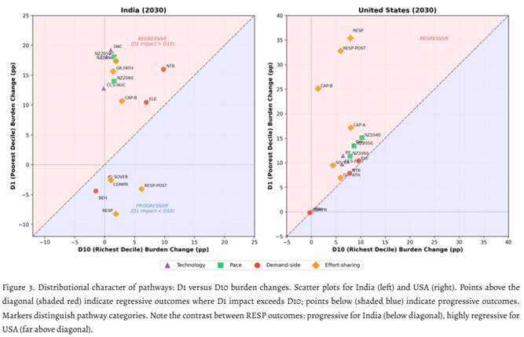

*A new study published in Environmental Research Letters examines how different climate mitigation strategies affect household energy affordability in India and the United States. By comparing 16 decarbonization pathways with similar long-term warming outcomes, the research reveals how policy design can influence the economic burdens faced by households across different income groups.*

{fig-align="center"}

Can climate policies achieve the same temperature goals while placing very different financial burdens on households? A new study published in Environmental Research Letters explores this question, revealing how different decarbonization strategies influence household energy costs, particularly for lower-income populations, and why achieving climate targets does not necessarily guarantee an equitable energy transition.

The study examines how different decarbonization pathways affeWWct household energy burdens in India and the United States, focusing on how climate policy choices influence affordability across income groups. Using GCAM v6.0 and household survey data, the authors compare 16 mitigation pathways with similar long-term warming outcomes, examining differences in technology, mitigation timing, energy demand, and international effort sharing while accounting for food expenditure.

This paper shows that cost-optimal, technology-focused, and mitigation-timing pathways generally place greater financial burdens on poorer households, while certain demand-reduction strategies can lower these burdens. By combining household income differences, food affordability, and international financial transfers within a common framework, the research provides a more comprehensive basis for evaluating the equity implications of future climate policies.

“Reaching the same climate target does not mean imposing the same burden on people,” said Prof. Haewon McJeon of KAIST Graduate School of Green Growth and Sustainability. “How we design the pathway matters, and climate policy should consider equitable impacts from the design stage.”

This research highlights that achieving climate targets is not only about reducing emissions but also about how the transition's economic costs are distributed. Its findings can help inform decarbonization strategies that balance climate ambitions with household energy affordability and social equity.

\[paper link\]: <https://doi.org/10.1088/1748-9326/aeb55d>
